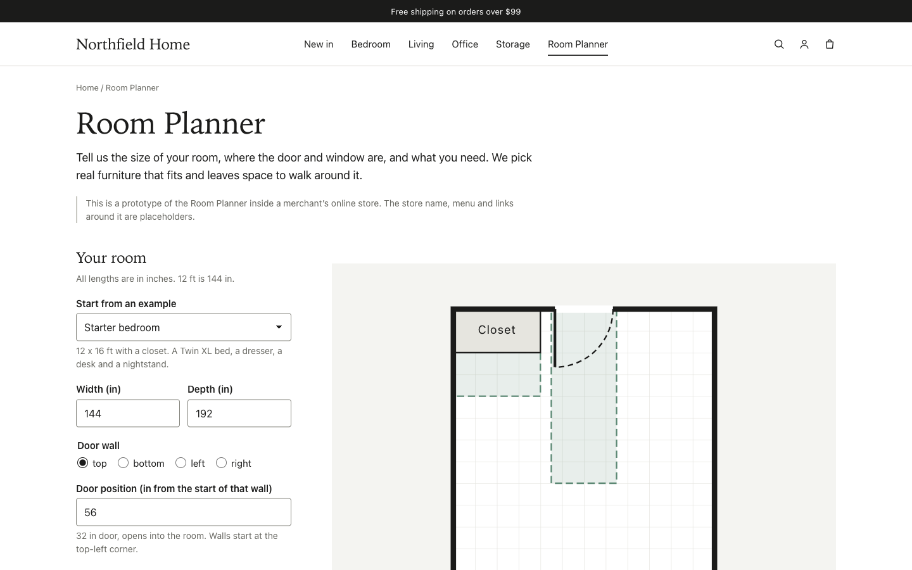
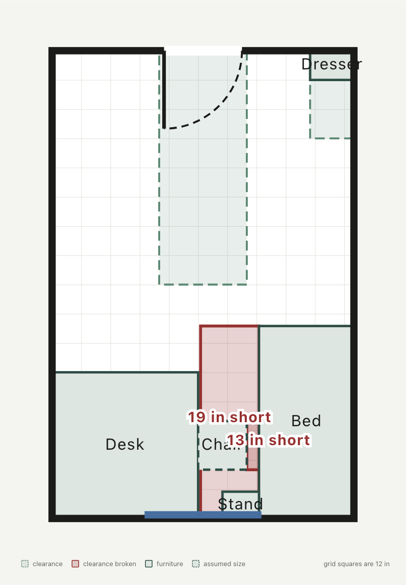
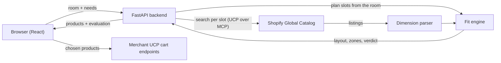

# Room Fit

Enter the size of a room and get real furniture from Shopify merchants that **fits together in it, with space to walk around**. Room Fit reads sizes out of product listings, places each piece in the room to scale, checks the clearances people actually need, and is honest about the listings that don't say how big they are.

It is a prototype for first-time renters and home buyers, built to be screen-recorded. It runs as a page of a placeholder online store ("Northfield Home") to show how it would sit inside a real merchant's site.



## The problem

Furnishing a first apartment means guessing. A listing says "60 inch desk", but not whether you can still open the door, get out of bed, or pull the chair out. And the sizes are hard to find:

- Shopify's catalog has **no dimensions field**. Sizes are buried in free-text descriptions, or missing.
- Of 25 desks a search returns, only about 21 state a usable size. For beds, as few as 5 of 25 do.
- A size can look usable and be wrong (a "Queen" frame listed 55 inches wide, or a box size mistaken for the product).

Room Fit puts the sizes to work. It reads what listings say, labels how far each size can be trusted, and shows the result on a floor plan so you can see what fits and what doesn't, before you buy.

## What it does

- **Room form** with examples: width, depth, door, window, closet, and the pieces you need (bed, nightstand, dresser, desk and chair). Seven preset rooms show how the result changes as the room or the need changes.
- **Real products, chosen to fit.** For each piece it searches Shopify's Global Catalog and picks the **cheapest listing that fits** its space without breaking a rule. The bed size follows the room (Twin XL up to King), or you can choose one.
- **To-scale floor plan** with the door swing, window, closet, furniture, and shaded clearance zones. A zone turns red and says how many inches short it is.
- **Fit rules**, checked live (values in [`backend/app/rules.py`](backend/app/rules.py)):

  | Rule | Value | Type |
  |---|---|---|
  | Clear path from the door | 36 in | Hard |
  | Open side of the bed (a twin may sit against a wall) | 24 in | Hard |
  | In front of a dresser or closet | 24 in | Hard |
  | Behind the desk chair | 18 in | Hard |
  | Floor covered by furniture | warn above 40%, flag above 45% | Soft |
  | A core need missing: sleep, study, storage | | Soft |

  The verdict is **Fits**, **Cramped** (a clearance is broken, or too full) or **Incomplete** (a need has no furniture).
- **Swap** any piece for another listing and see the clearances re-checked at once. Pieces are tried both ways round (long side along the wall, or turned 90 degrees).
- **Honest dimensions.** Every listing is labeled **stated** (a clear size in the description), **inferred** (Shopify's machine-guessed `tech_specs`, shown with a warning), **size unclear** (found but not trusted) or **dimensions missing**. Only stated and inferred sizes are ever placed. The page shows the data gap in numbers: "Of 25 desks Shopify returned, 21 list usable dimensions."
- **Size sanity check.** A bed whose listed frame is smaller than the mattress in its title is rejected.
- **Carts, never a purchase.** One cart per merchant through Shopify's UCP cart tools, with a link to continue on the merchant's own site. Carts are cancelled when you change the room, swap a product, or leave the page. The app never takes payment.



*A 60 × 60 in L-shaped desk in the "Narrow bedroom" example: 19 in short beside the bed and 13 in short behind the chair.*

## How it works



1. **Slots from the room.** The room is flipped so the door is on the top wall, then each piece gets a slot anchored to a wall or corner: the bed in the far corner on the roomier side of the door path, the desk opposite, the dresser on the door wall, the nightstand at the bed's head. If a slot has no room, the planner tries the mirrored layout or moves the desk to the door wall. A slot that still can't hold the smallest realistic piece says "no desk fits under these rules".
2. **Search.** One catalog search per piece, in parallel, within Shopify's 5 requests per second limit.
3. **Read the sizes.** A regex parser (no LLM) turns text like `39"W x 80"D x 14"H`, `120 cm` or `6'2"` into inches, and rejects shipping boxes, ranges, several sizes, quantities and parts. When the description gives nothing, `tech_specs` is the fallback.
4. **Place and check.** The fit engine snaps each product to its slot, then checks overlaps, walls, every clearance and the coverage.
5. **Pick.** The cheapest listing that fits and adds no new broken clearance wins each slot.

**Nothing is stored.** Shopify's usage terms limit caching product data, so Room Fit keeps no database and no product data on the server or in the repo. Products live in the browser's memory, and each room asks Shopify fresh. The only thing the server remembers is the access token, in memory, for under an hour. Tests use made-up listings and mocked HTTP.

### Built with

| | |
|---|---|
| Backend | Python 3.12, FastAPI, pydantic, httpx |
| Frontend | React 19, TypeScript, Vite |
| Tests | pytest, Vitest, React Testing Library |
| Quality | ruff, mypy (strict), ESLint, GitHub Actions |
| Data | Shopify Global Catalog and UCP (MCP over HTTP JSON-RPC) |

The frontend's TypeScript types are generated from the backend's OpenAPI file, so the two cannot drift. CI fails if they do.

## Getting started

**You need:** Python 3.12, Node 22, and Shopify catalog credentials: a client ID and secret from the Shopify Dev Dashboard (Agents, then your agent's API key and client secret).

```bash
git clone https://github.com/RickyDas999/RoomFit.git
cd RoomFit
```

**1. Backend** (terminal 1)

```bash
cd backend
python3.12 -m venv .venv && . .venv/bin/activate
pip install -e '.[dev]'
cp .env.example .env          # then put your SHOPIFY_CLIENT_ID and SHOPIFY_CLIENT_SECRET in .env
set -a; . ./.env; set +a      # the app reads them from the environment, not from the file
uvicorn app.main:app --reload
```

`.env` is git-ignored. Never commit credentials, and never paste them into a chat or an issue.

**2. Frontend** (terminal 2)

```bash
cd frontend
npm install
npm run dev
```

Open the address Vite prints (usually http://localhost:5173). The frontend proxies `/api` to the backend on port 8000. For another backend port: `API_URL=http://localhost:8001 npm run dev`.

Pick an example, press **Find furniture that fits**, open a piece's **Swap** list, then **Make a cart at each shop** and **Cancel carts**. The "Narrow bedroom" example is the one for seeing a clearance break after a swap.

**Troubleshooting**

| You see | Cause and fix |
|---|---|
| "Could not reach the Room Fit server" | The backend isn't running, or is on another port (use `API_URL`). |
| A 502 from the search | The credentials aren't in the backend's environment. Run the `set -a; . ./.env; set +a` line in the same shell as `uvicorn`. |
| "404 Not Found" at `localhost:8000` | Expected: the backend has only `/api/...` routes. The app is on the Vite port. |
| Page errors after an update | An older backend is still running on port 8000. Restart it. |
| Carts say "Invalid params" | The shop doesn't see the agent profile with cart support. See [Agent profile](#agent-profile). |

## API

| Route | What it does |
|---|---|
| `GET /api/health` | Liveness check. |
| `POST /api/evaluate` | Place the given products in a room and return the clearances, zones and verdict. No catalog call. |
| `POST /api/recommend` | Search the catalog for each needed piece, choose the cheapest set that fits, and return it with the swap candidates and the data-gap counts. |
| `POST /api/checkout` | Make one cart per merchant for the chosen products. |
| `POST /api/checkout/cancel` | Cancel carts made by the call above. |

The full contract is in [`backend/openapi.json`](backend/openapi.json); when the API changes, regenerate it with `python -m scripts.dump_openapi` (from `backend/`) and the frontend types with `npm run gen:api` (from `frontend/`).

## Testing

```bash
# backend (from backend/)
ruff check . && mypy app tests scripts && pytest

# frontend (from frontend/)
npm run lint && npx tsc -b && npm test && npm run build
```

About 2,400 backend and 300 frontend tests, none of which need credentials or the network. They cover each fit rule at its boundary, a table of dimension formats and the traps (box sizes, "fits mattress up to 80 in"), the planner on every door wall, rotation, the cart client against hostile shop answers, and the page's click-through of the storyboard. GitHub Actions runs both suites on every push and checks that the generated API types are current.

Two dev scripts print live catalog numbers and write nothing to disk (they need credentials):

```bash
python -m scripts.dev_catalog          # what each search returns
python -m scripts.dimension_report     # how many listings have usable sizes, by class
```

## Agent profile

Shopify identifies this app by an **agent profile**, [`agent-profile/ucp-profile.json`](agent-profile/ucp-profile.json), declaring the catalog, cart and checkout capabilities it uses. It is served by jsDelivr from a **commit-pinned URL** (`PROFILE_URL` in [`backend/app/catalog.py`](backend/app/catalog.py)), because Shopify caches a profile by URL and kept serving an old copy of a branch URL. **If you change the profile, commit it, then point `PROFILE_URL` at the new commit.** A test fails if they disagree.

## Repository layout

```
backend/app/      main.py (routes) · catalog.py (Shopify client) · dimensions.py (parser)
                  room.py (slots) · fit.py (fit engine) · rules.py (every rule value)
                  beds.py · cart.py · search.py
backend/tests/    pytest suites       backend/scripts/   dev tools and the OpenAPI dump
frontend/src/     App.tsx · components/ (form, floor plan, product rows, flags, cart, store chrome)
                  api/ (generated types + client) · room.ts · scenarios.ts
agent-profile/    the UCP agent profile
docs/             HANDOFF.md (product spec) · decisions-log.md (every decision, who made it)
```

## Limits and decisions worth knowing

- **Fixed slots, not auto-layout.** Furniture goes in computed places anchored to walls. There is no drag-and-drop and no search over arrangements, so an unusual room can report "doesn't fit" when a human could rearrange it.
- **US only, USD only**, for now.
- **Results change between runs**, because they come live from the catalog. The desk chair's size is assumed to be 20 × 20 in, since chair listings rarely give one (the page says so).
- **No purchase, by design.** The app never calls any complete-checkout tool. No live product is flagged for Shopify's native checkout today, so carts are used instead of checkout sessions.
- **Prototype security.** The shop address for a cart comes from the browser, and a public hostname that resolves to a private address is not blocked. The server only sends JSON to port 443 of that host, with size and time limits. Fine locally, but not for a public deploy.
- Every product decision is recorded in [`docs/decisions-log.md`](docs/decisions-log.md); the original spec is [`docs/HANDOFF.md`](docs/HANDOFF.md).

## Future work

- Floor plan upload and parsing
- Auto-layout and drag-and-drop placement
- Color, palette and theme matching (the catalog has no color data; image similarity is one route)
- "Complete this look from one shop", for fewer checkouts
- A language-model layer for messy dimension text, if patterns prove too weak on real data
- Several rooms or a whole home
- UCP checkout sessions with a human in the loop, once merchants enable native checkout
- Currencies and countries beyond the US

## How it was built

Built with [Claude Code](https://claude.com/claude-code) as the implementation agent, working to the spec in `docs/HANDOFF.md` one milestone at a time (a pull request each, with independent test-writing and review passes). The owner reviewed and merged every pull request and made every product decision.

## License

No license has been chosen yet, so all rights are reserved by default.
